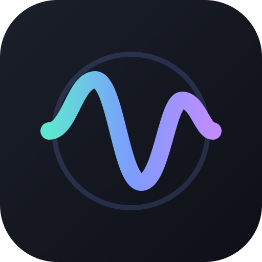

<p align="center"></p>

# Ondaria

Ondaria è una DAW open source per **Linux e Windows**, pensata per un flusso di lavoro basato su clip, scene e device, con un host di plugin che carica tutti i formati principali.

Il progetto è un'implementazione originale (codice, nome e grafica) e non contiene codice o risorse di altre DAW commerciali.

> Stato: **in sviluppo** (fase 4 della roadmap). Ci sono la session view con clip e scene lanciate a tempo, l'arrangement con la linea del tempo, il piano roll, il mixer per traccia e i plugin di ogni formato. C'è la registrazione audio e MIDI, nell'arrangement e negli slot. Automazioni ed export sono i prossimi passi.

## Cosa c'è già

- **Motore audio** basato su [Tracktion Engine](https://github.com/Tracktion/tracktion_engine) 3.5 e [JUCE](https://juce.com) 9.
- **Host dei plugin multi-formato:**

  | Formato | Linux | Windows | Implementazione |
  | --- | --- | --- | --- |
  | VST3 | sì | sì | JUCE |
  | CLAP | sì | sì | host nostro (`src/host/ClapPluginFormat.cpp`) |
  | LV2 | sì | sì | JUCE |
  | LADSPA | sì | no | JUCE |
  | VST2 | opzionale | opzionale | JUCE, solo se compilato con l'SDK VST2 (`-DSONORA_VST2_SDK_DIR=...`) |

- **Scansione isolata:** ogni file di plugin viene aperto da `sonora-plugin-scanner`, un processo separato. Se un plugin va in crash o si blocca, finisce nella lista di esclusione e la DAW resta aperta.
- **Interfaccia moderna e minimal:** tema scuro, font Inter e JetBrains Mono, colore solo dove porta informazione.
- **Session view:** una colonna per traccia e una riga per scena. Le clip si lanciano a tempo con la quantizzazione scelta (da nessuna a 8 battute); lanciare una scena fa partire tutta la riga, e gli slot vuoti lasciano suonare la traccia.
  - Triangolo della clip: la lancia. Doppio clic su uno slot vuoto: nuova clip MIDI. Trascina un file audio o MIDI su uno slot per importarlo.
  - Invio lancia, Canc elimina, frecce per muoversi; clic destro per rinominare, cambiare colore, inserire o eliminare.
- **Arrangement:** la linea del tempo con una corsia per traccia, separata dalla session view come in un flusso a due viste.
  - Doppio clic su una corsia vuota: nuova clip MIDI di una battuta. Trascina una clip per spostarla (anche su un'altra traccia), trascina il bordo destro per allungarla; tutto segue la griglia scelta.
  - Ctrl+D duplica, Canc elimina, clic destro per il menu. Trascina file audio o MIDI dal browser o dal sistema per importarli nel punto giusto.
  - Clic sul righello per spostare la testina, Shift+trascina per impostare il loop. Ctrl+rotella per lo zoom, "Adatta" per vedere tutto il brano.
  - Se una traccia sta suonando le clip della session, il pulsante "Torna all'arrangement" la riporta alla linea del tempo.
- **Registrazione:**
  - Ogni traccia ha un ingresso (tutti gli ingressi MIDI, un ingresso audio o nessuno), scelto dal menu della traccia, e un pulsante di armamento accanto a M e S.
  - La traccia selezionata con ingresso MIDI è armata in automatico (cerchio più tenue): la tastiera la suona e la registra subito.
  - F9 o il pulsante rosso registra nell'arrangement sulle tracce armate.
  - Session: sulle tracce armate gli slot vuoti mostrano un cerchio. Cliccalo per registrare dal prossimo punto di quantizzazione; cliccalo di nuovo per fermarti a tempo: la clip parte subito in loop.
- **Cattura retroattiva:** Ondaria ascolta sempre gli ingressi, anche senza registrare (MIDI degli ultimi minuti, audio dell'ultimo minuto). Il pulsante con la freccia accanto alla registrazione si accende quando hai suonato qualcosa su una traccia armata. Premilo (o Ctrl+Shift+C) e l'ultima idea suonata diventa una clip:
  - se il brano andava, la clip è allineata alle battute dove l'hai suonata; nella session parte subito in loop, in fase con il resto;
  - a trasporto fermo diventa un loop nuovo al tempo del progetto, lungo 1, 2, 4... battute;
  - nella session va nel primo slot libero della traccia, nell'arrangement sulla linea del tempo;
  - funziona con il MIDI (anche dalla tastiera su schermo) e con l'audio: la parte prima dell'ultima pausa lunga resta fuori.
- **Automazioni:** volume, pan e qualsiasi parametro dei device cambiano nel tempo seguendo una curva.
  - Nell'arrangement il pulsante con la spezzata nell'intestazione della traccia sceglie quali parametri mostrare: ognuno ha la sua corsia sotto la traccia (un pallino nel menu indica quelli che hanno già dei punti).
  - Nella corsia: clic per aggiungere un punto e trascinarlo, doppio clic per toglierlo, Alt+trascina un tratto per curvarlo, Ctrl per non agganciarsi alla griglia. Col tasto destro si cancella tutto o si nasconde la corsia.
  - Il pulsante con la spezzata nella barra superiore accende la scrittura: mentre il brano suona, i movimenti di manopole e fader diventano punti e la corsia si apre da sola. Da spento non si scrive mai niente per sbaglio.
- **Piano roll:** clic per scrivere una nota (trascina per decidere la durata), trascina per spostare o allungare, doppio clic per cancellare; velocity in basso, griglia da 1/4 a 1/32 e terzine, quantizzazione, frecce per trasporre (Shift per l'ottava).
- **Mixer per traccia:** volume, pan, mute, solo e meter; volume e meter del master.
- **Barra superiore:** trasporto, posizione, tempo (trascina o doppio clic per scriverlo), metro, quantizzazione del lancio, loop, metronomo, undo/redo.
- **Palette comandi (Ctrl+K):** cerca e avvia qualsiasi azione o aggiungi un device scrivendone il nome.
- **Browser** con una sola ricerca e filtri (strumenti, effetti, plugin, campioni). I campioni si trascinano sugli slot.
- **Catena di device** per traccia con le manopole dei primi parametri; ogni device si apre, si disattiva o si rimuove.
- **Device che si vedono:** l'EQ mostra la sua curva con un punto per banda da trascinare (rotella per la larghezza, doppio clic per azzerare), il filtro la curva con la frequenza di taglio, il compressore la curva ingresso/uscita con la soglia da trascinare. Delay, riverbero, chorus, phaser e synth mostrano ripetizioni, coda, LFO in movimento e inviluppo.
- **Animazioni e colore:** la testina scorre fluida in arrangement e piano roll, le clip si illuminano quando partono e pulsano a tempo, i pannelli si aprono con una transizione morbida. Il colore della traccia segue la traccia ovunque: intestazioni, fader, mixer, device e corsie. I meter tengono il picco per un attimo prima di farlo scendere.
- **Progetti:** nuovo, apri, salva, salva con nome. Ogni modifica si annulla con Ctrl+Z.
- **Export (Ctrl+Shift+R):** il brano intero o solo il loop diventa un file WAV (16, 24 o 32 bit float), FLAC, MP3 (192-320 kb/s) o Ogg Vorbis, a 44.1, 48 o 96 kHz. Con "Stem" esce un file per ogni traccia con clip, numerato e allineato all'inizio del brano, pronto da importare altrove. Si può normalizzare il picco a -0.3 dB e lasciar finire riverberi e delay oltre la fine. Il render gira in sottofondo con la sua barra di avanzamento. L'MP3 usa la libreria LAME del sistema: su Arch `pacman -S lame`, su Windows `libmp3lame.dll` accanto al programma.
- **Tastiera MIDI su schermo** per suonare gli strumenti anche senza controller.

### Scorciatoie

| Tasto | Azione |
| --- | --- |
| Spazio | Riproduci / ferma |
| Tab | Session view / arrangement |
| Ctrl+K | Palette comandi |
| Ctrl+T | Nuova traccia |
| Ctrl+Z, Ctrl+Shift+Z | Annulla, ripeti |
| Ctrl+N, Ctrl+O, Ctrl+S, Ctrl+Shift+S | Nuovo, apri, salva, salva con nome |
| Ctrl+F | Cerca nel browser |
| F9 | Registra nell'arrangement |
| Ctrl+Shift+C | Cattura quello che hai appena suonato |
| Ctrl+Shift+R | Esporta audio (mix o stem) |
| Ctrl+D | Duplica la clip (arrangement) |
| Canc | Elimina la clip o le note selezionate |

## Scaricare una versione pronta

Ogni build della CI produce un pacchetto per Linux (`Ondaria-linux-x64.tar.gz`) e uno per Windows (`Ondaria-windows-x64.zip`): apri la scheda **Actions**, scegli l'ultima esecuzione riuscita e scarica l'artefatto in fondo alla pagina. Tieni `ondaria-plugin-scanner` nella stessa cartella di Ondaria.

Su Linux, dopo aver estratto il pacchetto, `./installa.sh` aggiunge Ondaria al menu delle applicazioni con la sua icona (solo per il tuo utente, senza sudo). Su Windows l'icona è già dentro `Ondaria.exe`.

## Compilare

Requisiti: CMake 3.22+, un compilatore C++20 (GCC 11+, Clang 14+ o Visual Studio 2022).

```bash
git clone --recurse-submodules <url-del-repository> ondaria
cd ondaria
```

**Linux (Ubuntu/Debian):**

```bash
sudo apt install ninja-build libasound2-dev libjack-jackd2-dev ladspa-sdk libfreetype-dev \
  libfontconfig1-dev libx11-dev libxcomposite-dev libxcursor-dev libxext-dev libxinerama-dev \
  libxrandr-dev libxrender-dev libxi-dev libglu1-mesa-dev mesa-common-dev libgl-dev
cmake -S . -B build -G Ninja -DCMAKE_BUILD_TYPE=Release
cmake --build build
./build/Sonora_artefacts/Release/Ondaria
# facoltativo: installa app, voce di menu e icona (prefisso predefinito /usr/local)
sudo cmake --install build --component ondaria
```

**Windows (Visual Studio 2022):**

```powershell
cmake -S . -B build -G "Visual Studio 17 2022" -A x64
cmake --build build --config Release
.\build\Sonora_artefacts\Release\Ondaria.exe
```

**Test:** `ctest --test-dir build -C Release --output-on-failure`. I test caricano due plugin CLAP di prova (uno valido e uno che va in crash) e verificano parametri, audio, note, stato, latenza e scansione isolata.

## Struttura

```
src/app/       interfaccia: tema, barra superiore, session view, browser, catena di device, palette comandi
src/session/   logica della session view (clip, scene, lancio quantizzato), separata dall'interfaccia
src/host/      host dei plugin: formato CLAP, registro dei formati, scansione isolata
src/scanner/   ondaria-plugin-scanner, il processo che scansiona un plugin alla volta
tests/         test automatici e plugin CLAP di prova
external/      sottomoduli: Tracktion Engine (con JUCE) e SDK CLAP
docs/          architettura e roadmap
resources/     font dell'interfaccia (Inter e JetBrains Mono, SIL Open Font License), icona dell'app, file .desktop per Linux
```

## Licenza

AGPL-3.0-or-later (vedi `LICENSE`). JUCE è distribuito con licenza AGPLv3 e Tracktion Engine con GPLv3 o successiva, entrambe compatibili. I font Inter e JetBrains Mono sono distribuiti con la SIL Open Font License 1.1 (testi in `resources/fonts`).
